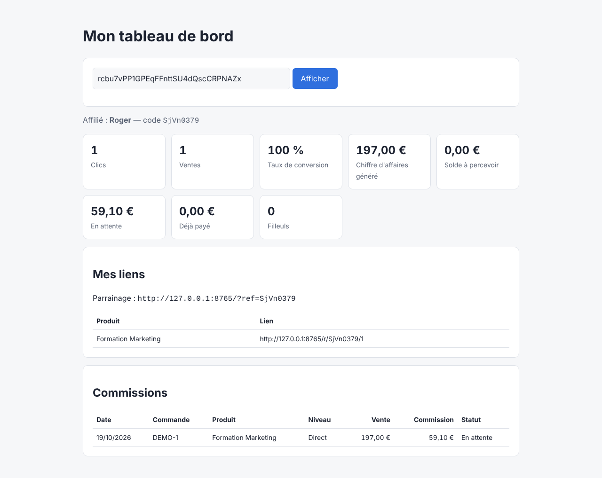

# Système de marketing d'affiliation

Plateforme d'affiliation complète, sans dépendance externe (Python 3.10+ et SQLite uniquement) :

- **Inscription des affiliés** avec clé API personnelle et liens de suivi par produit
- **Suivi des clics** (`/r/<code>/<produit>`) avec cookie de 30 jours et identifiant visiteur transmis au marchand
- **Attribution des ventes** au dernier clic, ou par code affilié (coupon) en repli
- **Commissions** en pourcentage ou montant fixe, par produit
- **Affiliation à 2 niveaux** : le parrain touche 10 % (configurable) de la commission de ses filleuls
- **Cycle de paiement** : en attente → approuvée / refusée → payée
- **Tableau de bord affilié** (clics, ventes, taux de conversion, CA, solde, filleuls)
- **Console d'administration** (produits, classement des affiliés, validation et paiement des commissions)



## Démarrage

```bash
cd affiliate-system
export AFFILIATION_ADMIN_TOKEN="un-jeton-long-et-secret"
python3 -m affiliation.server
```

Puis ouvrez :

| Page | URL |
|---|---|
| Inscription affilié | http://127.0.0.1:8000/ |
| Tableau de bord affilié | http://127.0.0.1:8000/dashboard |
| Administration | http://127.0.0.1:8000/admin |

### Configuration (variables d'environnement)

| Variable | Défaut | Rôle |
|---|---|---|
| `AFFILIATION_ADMIN_TOKEN` | *(obligatoire)* | Jeton d'accès admin / API marchand |
| `AFFILIATION_HOST` / `AFFILIATION_PORT` | `127.0.0.1` / `8000` | Adresse d'écoute |
| `AFFILIATION_DB` | `affiliation.db` | Fichier SQLite |
| `AFFILIATION_BASE_URL` | `http://host:port` | URL publique utilisée dans les liens générés |
| `AFFILIATION_TIER2_RATE` | `0.10` | Part reversée au parrain (0 pour désactiver) |

## Fonctionnement

1. L'administrateur crée un produit (URL de la page de vente + commission).
2. L'affilié s'inscrit et reçoit ses liens : `https://votre-domaine/r/<code>/<id_produit>`.
3. Un visiteur clique : le clic est enregistré puis le visiteur est redirigé vers la page de vente,
   avec le paramètre `aff_vid=<identifiant>` ajouté à l'URL.
4. Le site marchand conserve `aff_vid` (cookie, session...) et, lors de l'achat, déclare la vente :

```bash
curl -X POST https://votre-domaine/api/conversions \
  -H "Authorization: Bearer $AFFILIATION_ADMIN_TOKEN" \
  -d '{"order_id": "CMD-1001", "product_id": 1, "amount": 197, "visitor_id": "<aff_vid>"}'
```

   Sans `visitor_id`, vous pouvez passer `"affiliate_code"` (ex. code promo saisi par le client).
   Un même `order_id` ne peut être enregistré qu'une fois.

5. La commission est créée « en attente ». L'administrateur l'approuve (après le délai de rétractation,
   par exemple) puis paie l'affilié depuis la console.

## API

| Méthode | Chemin | Auth | Description |
|---|---|---|---|
| GET | `/api/products` | – | Liste des produits |
| POST | `/api/affiliates` | – | Inscription `{name, email, parent_code?}` |
| GET | `/api/me` | `X-Api-Key` | Stats, liens et commissions de l'affilié |
| GET | `/r/<code>/<id>` | – | Lien de suivi (redirection 302) |
| POST | `/api/products` | Admin | `{name, url, commission_type: percent\|fixed, commission_value}` |
| POST | `/api/conversions` | Admin | Déclare une vente |
| GET | `/api/admin/overview?status=` | Admin | Classement, produits, commissions |
| POST | `/api/commissions/<id>/status` | Admin | `{status: approved\|rejected\|paid}` |
| POST | `/api/affiliates/<id>/pay` | Admin | Paie toutes les commissions approuvées |

Admin = en-tête `Authorization: Bearer <AFFILIATION_ADMIN_TOKEN>`.

## Tests

```bash
cd affiliate-system
python3 -m unittest -v
```

## Mise en production

Placez le serveur derrière un reverse proxy HTTPS (nginx, Caddy) et définissez `AFFILIATION_BASE_URL`
avec votre domaine public. Les clés API des affiliés sont stockées hachées (SHA-256) et les adresses IP
des clics sont hachées avant enregistrement.
