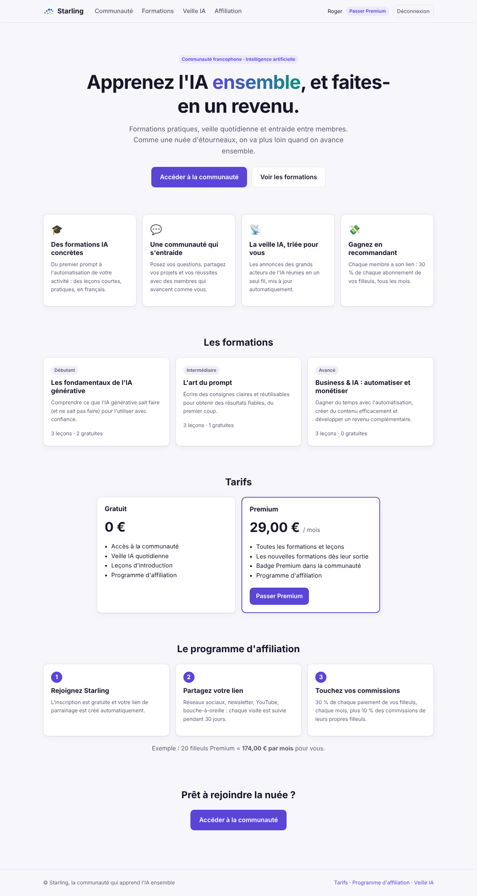
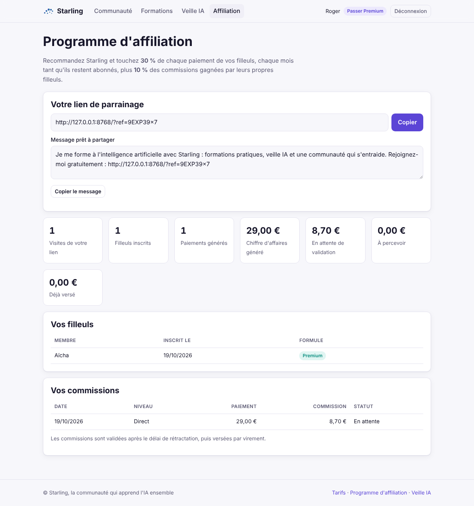
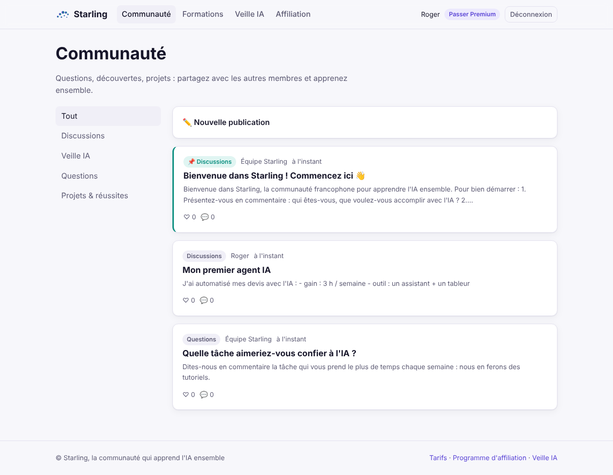
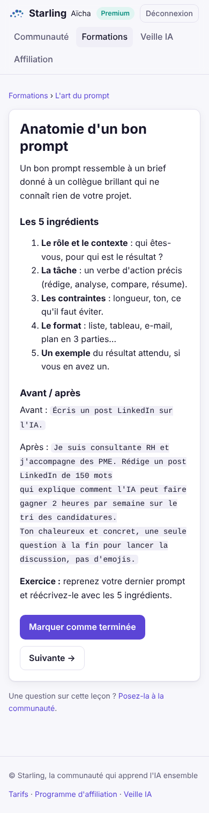
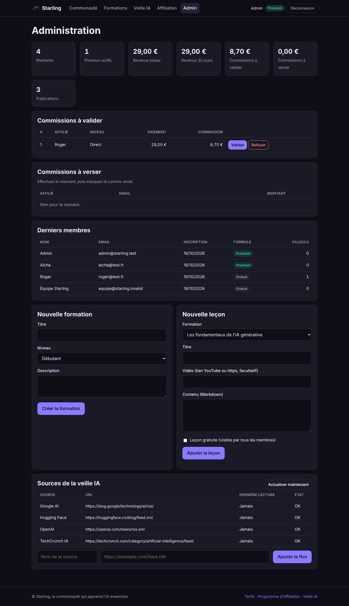

# Starling

**La communauté francophone pour apprendre l'IA ensemble, et en faire un revenu.**

Starling est une plateforme SaaS qui réunit trois choses :

- des **formations à l'intelligence artificielle** (leçons gratuites + formule Premium par abonnement) ;
- une **communauté** d'entraide (publications, commentaires, j'aime, catégories) et une **veille IA** alimentée automatiquement par des flux RSS ;
- un **programme d'affiliation intégré** : chaque membre a son lien de parrainage et touche une commission
  **récurrente** sur les abonnements de ses filleuls, plus une part des commissions de leurs propres filleuls (2 niveaux).

Comme une nuée d'étourneaux (*starlings*), la communauté grandit parce que chaque membre en entraîne d'autres.



| Programme d'affiliation | Communauté |
|---|---|
|  |  |

| Leçon (mobile) | Administration (thème sombre) |
|---|---|
|  |  |

## Démarrage en 1 minute

Aucune dépendance à installer : Python 3.10+ suffit (SQLite est inclus).

```bash
cd starling
export STARLING_ADMIN_EMAIL="vous@exemple.com"   # ce compte aura accès à /admin
python3 -m community
```

Ouvrez http://127.0.0.1:8000, inscrivez-vous avec l'email administrateur, et explorez.
Au premier lancement, Starling installe un contenu de départ : 3 formations (9 leçons), un message
de bienvenue épinglé et 4 sources de veille IA.

Sans clés Stripe, la plateforme tourne en **mode démo** : le bouton « Passer Premium » active
l'abonnement sans paiement réel, ce qui permet de tester tout le parcours, commissions comprises.

## Fonctionnalités

| Espace | Ce qu'on peut y faire |
|---|---|
| **Accueil** | Présentation, catalogue, tarifs, explication du programme d'affiliation. Un lien `/?ref=CODE` affiche « X vous invite » et mémorise le parrain pendant 30 jours. |
| **Formations** | Parcours par niveau, leçons en Markdown avec vidéo YouTube optionnelle, suivi de progression, leçons gratuites ou réservées aux membres Premium. |
| **Communauté** | Fil par catégorie (Discussions, Veille IA, Questions, Projets & réussites), publications épinglées, commentaires, j'aime, badge Premium, suppression par l'auteur ou un admin. |
| **Veille IA** | Articles récupérés toutes les heures depuis des flux RSS/Atom configurables. |
| **Affiliation** | Lien et message prêts à partager, visites, filleuls, paiements générés, commissions (en attente, à percevoir, versées). |
| **Administration** | Indicateurs (membres, Premium, revenus, commissions), création de formations et de leçons, validation et versement des commissions, gestion des sources de veille. |

### Comment les commissions sont calculées

Avec la configuration par défaut (29 €/mois, 30 %, 2e niveau à 10 %) :

- Aïcha s'inscrit via le lien de Roger, puis s'abonne : **Roger touche 8,70 € à chaque paiement mensuel** d'Aïcha.
- Si Roger a lui-même été parrainé par Fatou, **Fatou touche 0,87 €** (10 % de la commission de Roger).
- Chaque commission est créée « en attente », validée par l'admin après le délai de rétractation, puis
  marquée « versée » une fois le virement effectué.

## Configuration

| Variable | Défaut | Rôle |
|---|---|---|
| `STARLING_ADMIN_EMAIL` | – | Email du compte administrateur |
| `STARLING_BASE_URL` | `http://hôte:port` | URL publique (utilisée dans les liens de parrainage). Avec `https://`, les cookies sont marqués `Secure`. |
| `STARLING_HOST` / `STARLING_PORT` | `127.0.0.1` / `8000` | Adresse d'écoute |
| `STARLING_DB` | `starling.db` | Fichier SQLite |
| `STARLING_PRICE` | `29` | Prix mensuel Premium affiché (€) |
| `STARLING_COMMISSION` | `30` | Commission de niveau 1 (% de chaque paiement) |
| `STARLING_TIER2_RATE` | `0.10` | Part reversée au parrain du parrain (0 pour désactiver) |
| `STARLING_NEWS_INTERVAL` | `3600` | Fréquence de mise à jour de la veille, en secondes (0 pour désactiver) |
| `STARLING_SEED` | `1` | `0` pour ne pas installer le contenu de départ |
| `STRIPE_SECRET_KEY`, `STRIPE_PRICE_ID`, `STRIPE_WEBHOOK_SECRET` | – | Active les vrais paiements (voir ci-dessous) |

## Encaisser de vrais abonnements avec Stripe

1. Dans le tableau de bord Stripe, créez un produit « Starling Premium » avec un **prix récurrent mensuel**
   (le même montant que `STARLING_PRICE`). Notez l'identifiant `price_...`.
2. Créez un webhook vers `https://votre-domaine/webhooks/stripe` avec les événements
   `checkout.session.completed`, `invoice.paid` et `customer.subscription.deleted`. Notez le secret `whsec_...`.
3. Lancez Starling avec `STRIPE_SECRET_KEY`, `STRIPE_PRICE_ID` et `STRIPE_WEBHOOK_SECRET`.

Chaque facture payée prolonge l'accès Premium jusqu'à la fin de la période et crée les commissions
des parrains. Les webhooks sont vérifiés (signature HMAC, horodatage) et rejouables sans risque de doublon.

## Mise en ligne

- Un petit serveur (VPS) suffit pour démarrer. Placez Starling derrière un reverse proxy HTTPS
  (Caddy ou nginx) et définissez `STARLING_BASE_URL=https://votre-domaine`.
- Sauvegardez régulièrement le fichier SQLite (`STARLING_DB`).
- Avant d'ouvrir au public : mentions légales, CGV, politique de confidentialité (RGPD) et conditions
  du programme d'affiliation. Faites valider le traitement fiscal des commissions par un expert-comptable.

## Sécurité

Mots de passe hachés (PBKDF2-SHA256), sessions en cookies `HttpOnly` / `SameSite=Lax`, jeton CSRF sur
tous les formulaires, contenu des membres échappé (Markdown sans HTML), en-têtes CSP et anti-clickjacking,
adresses IP des visiteurs hachées, redirections après connexion limitées au site.

## Architecture

```
starling/
├── affiliation/      Moteur d'affiliation (clics, attribution, commissions, paiements)
│   └── server.py     API d'affiliation autonome, utilisable sans la communauté
├── community/        Application Starling
│   ├── models.py     Membres, sessions, formations, communauté, veille, abonnements
│   ├── web.py        Serveur HTTP et pages
│   ├── payments.py   Stripe Checkout et webhooks
│   ├── news.py       Lecture des flux RSS/Atom
│   ├── markdown.py   Rendu Markdown sûr
│   └── seed.py       Contenu de départ
└── tests/
```

Le moteur d'affiliation reste utilisable seul pour une boutique externe : voir `python3 -m affiliation.server`
(jeton `AFFILIATION_ADMIN_TOKEN`, API `/api/conversions`).

## Tests

```bash
cd starling
python3 -m unittest -v
```
